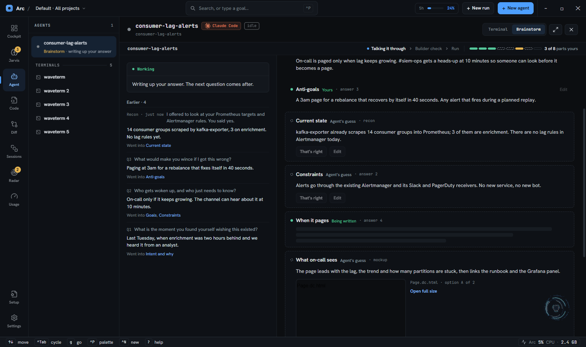
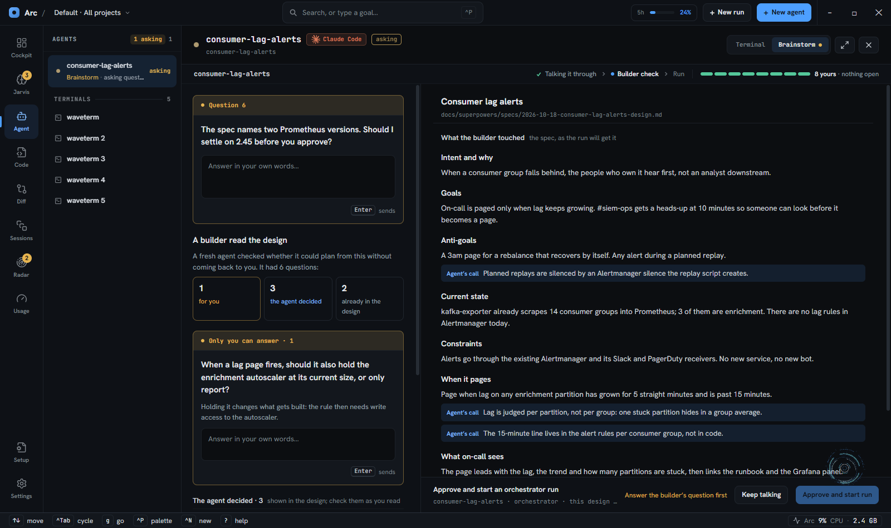
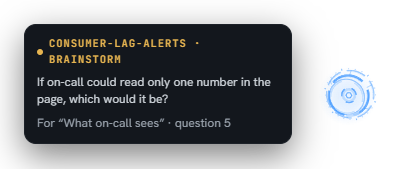

# Brainstorm mode: an agent's brainstorm beside its terminal

When an agent inside Arc runs `superpowers:brainstorming`, Arc draws the brainstorm on the Agent
surface in place of the terminal: the question it is waiting on, with an answer box, the design's
parts as they form, mockups beside their parts, and at the end a builder check and the start of an
orchestrator run. `b` (or the header's **Terminal | Brainstorm** switch) flips between the two; the
terminal stays mounted underneath.

The design and the reasons behind it are in `docs/superpowers/specs/2026-10-18-brainstorm-mode-design.md`.
The agent's half of the protocol is `skills/brainstorm/SKILL.md` (`arc:brainstorm` in Claude Code).
This page is how the pieces fit, what each action sends, and how to test it.

## The model in one paragraph

The brainstorm's state is one file the agent writes,
`<project>/.superpowers/brainstorm/<topic>/brainstorm.json` (gitignored). Arc never writes it: it
polls the file and draws it, and every action in the pane reaches the agent as **one line**, sent to
it as a prompt. An answer is sent as typed; every other action is a `brainstorm:` line the skill
defines. One writer means no merge, and the file is what survives a compaction, an Arc restart and
the agent exiting.

## How a brainstorm attaches

1. The agent invokes the `Skill` tool for `superpowers:brainstorming`. A synchronous PostToolUse hook
   (matcher `Skill`, `wsh agent-hook --skill-context`, registered by `install-agent-hooks`) adds
   context telling it to also follow `arc:brainstorm`. The agent then loads that skill itself.
2. The agent creates `brainstorm.json` with its file-writing tool. The async PostToolUse hook
   (`brainstormRevealFor` in `cmd/wsh/cmd/wshcmd-agenthook.go`) sees the path and sends
   `wsh ui reveal brainstorm:<topic>` for it: the switch appears, the tree line reads
   "Brainstorm · asking question 1", and the tab meta `session:brainstorm` records the file's path.
   Pi and opencode have no such hook; the skill has them run the reveal themselves.
3. `BrainstormPoller` (mounted in the cockpit root) reads every attached brainstorm's file every
   3 s (`BRAINSTORM_POLL_MS`). After a restart it re-attaches every agent whose tab carries
   `session:brainstorm`. One unreadable read is taken for an agent mid-write; the second in a row
   shows "Arc could not read the latest brainstorm.json" over the last good contents.

**Agents a run starts are left out.** `pkg/jarvis` sets `ARC_RUN_AGENT=1` in the environment of every
agent an Arc run launches (`jarvis.RunAgentEnv`). The skill-context hook adds nothing for them, and
the skill tells them not to use it: a lead routes every question through AskUserQuestion or
`wsh ask`, which the cockpit shows instead.

## What each action sends

| In the pane | Line the agent gets | The agent then |
|---|---|---|
| Type an answer, Enter | the answer, joined onto one line | records the exchange, writes the part, asks the next question |
| Type a line with no question open, Enter | the line, joined onto one line | reads it as pushback or a question back, replies under a new question, sets `done` false |
| Guess for me | `brainstorm: guess` | writes its own guess for the asked part, asks the next question |
| Skip the questions | `brainstorm: skip questions` | writes every open part as a guess, sets `done` |
| That's right | `brainstorm: confirm <part>` | makes the part yours |
| Confirm all N guesses | `brainstorm: confirm every guess` | makes every plain guess yours (a changed part still waits) |
| Edit, Enter | `brainstorm: edit <part>: <text>` | replaces the part's body, makes it yours |
| Keep the change / Put mine back | `brainstorm: keep <part>` / `brainstorm: restore <part>` | settles a part it changed after you confirmed it |
| Keep all N changes | `brainstorm: keep every change` | keeps every part it changed after you confirmed it |
| Check with a builder | `brainstorm: check` | writes the spec, runs `wsh brainstorm check <brainstorm.json>`, ends its turn; Arc launches the reviewer |
| (the reviewer is done) | `brainstorm: builder questions <path>`, sent by the server | reads the questions file, sorts it into `check`, folds it into the parts and the spec |
| Try again (check failed) | `brainstorm: check` | the same as Check with a builder |
| Answer a builder question | `brainstorm: builder answer: <text>` | folds it into the part and the spec |
| Keep talking | `brainstorm: keep talking` | clears `done` and `check`, asks again |
| Approve and start run | `brainstorm: approved`, then the launcher opens | stops; does not start a run itself |
| (the run starts) | `brainstorm: run <id>`, sent by the launcher | records `run` |

Lines go out through `AgentPromptCommand` (`brainstormsend.ts`), the same path canvas marks use:
a session whose arc mod holds a control stream runs the line as a prompt, leaving a half-typed draft
in the composer alone; any other session has it typed.

## Why the pane says "Working" before the file changes

The agent writes the file **once per turn**, at the end. So that the pane does not sit on a stale
question for the whole turn, Arc records the line it sent (`sent` in the brainstorm state) and draws
the file as if the agent had set `working`. An answer closes the question card and shows its part as
"Being written"; any other line shows "Taking in your change." Every button that sends is disabled
meanwhile, so a second line cannot be sent into a running turn.

The poller settles the sent line (`settleSent` in `brainstormmodel.ts`) when the agent's turn ends
after the send, or when the file has changed and the agent is not at work. A write in the middle of a
turn does not settle it.

The one-write rule is about cost as much as tidiness. With two whole-file writes per answer, the
end-to-end test measured output growing from 1.8k to 6.5k tokens per answer, and 56 s per answer
once the file reached 6.8 KB. The skill now has the agent make small changes with a one-line
read-modify-write script: a confirm done that way took 574 tokens and 8 s, against 4.3k tokens and
30 s for a retyped file. In the dev app an answer now comes back with the next question in about 7 s.

## The three phases

**Talking it through.** One question at a time, each naming the part it is for. Parts are `yours`,
`guess` (dashed, with That's right and Edit), `asked` or `open`. "Before the builder check" lists
every part that is not yours yet, with Confirm all once there are two or more plain guesses.

A part an answer made yours shows that answer beside it, from the file's history (`partAnswer`):
under the gist, `answer 11: “Dark, like the spike”`, on one line until the row opens. It is how a
part that says more than the user did (a board, a named option the answer never picked) stands out
before the builder check and approval; the skill keeps such a part a guess. A question dropped after
pushback is a `superseded` history entry: the rail shows it as dropped, it counts as no answered
question, and the part it was asked for reads "Open · question N dropped" until a question asks it
again.

**What is new.** While a question is open it fills the pane, so notes and recon the agent adds then
(a report the user asked for, say) are out of sight. Arc remembers, per brainstorm file, what the
user has seen (`brainstormSeenAtom` in `brainstormstore.ts`): the file as first read, then the file as
the design last drew it, taken when the design closes. Parts whose text changed since then and recon
entries not seen before are new (`unseenSince` in `brainstormmodel.ts`): a part row reads "New", a
recon row in the rail "Recon · new", and while new notes exist the question shows **New findings · N**,
which opens the design with those notes open. Coming back from the design clears the marks. A part
whose state alone changed (a confirm) is not new. The skill puts a summary of any report in the
question's `why` too, since the link says only how many notes there are.

A part's mockups draw under its body when its row opens: each board a scaled live thumbnail with
Open full size (the canvas), each of its `spikes` (a throwaway live page under the canvas folder, for
motion a board cannot show) a link that opens it in the browser from the same served folder.
`PartMockups` in `brainstormui.tsx` draws both, from `partBoards` and `partSpikes`.

**Builder check.** Check with a builder appears once the agent sets `done`, no question is open and
every part is yours.

The check view shows what a fresh builder asked: the questions only you can answer, the calls the
agent made (marked "Agent's call" in the spec and under their parts), and what the design already
answered. Approve stays off until every builder question has an answer. While the reviewer works the
pane shows "A builder is reading the design." and Check with a builder is unavailable.

The check's review keeps every part's mockups reachable while the user confirms the design: a review
row whose part has a board or a spike opens to them (even a row new since the check, which has
nothing it was), and so does a part opened from the "Yours, unchanged" and notes links under it.

Any question the agent waits on is in the file's `question`, in every phase. A question about no
part (a choice the agent needs before it can go on) shows as a plain "Question N" card, without
Guess or Skip; in the check view it sits above the builder's summary.

Whenever no question is open (the design after `done`, parts waiting on keep or restore, the builder
check's review) a box under the main area takes a line of the user's own: a pushback or a question
back. It sends the raw line as the answer box does, and is locked while the agent writes
(`lineBox` in `brainstormmodel.ts`, `LineBar` in `brainstormui.tsx`). The skill has the agent reply
by opening a question under the next `n` whose `why` leads with the reply, set `done` false, and
rewrite the parts the line changes. A run that has started takes no line.

**Run.** Approve sends `brainstorm: approved` and opens + New run prefilled: orchestrator, the
agent's project, a goal naming the spec's absolute path, and as prototype the first mockup board any
part lists. When the run starts, the launcher sends `brainstorm: run <id>`; the bar then reads
"Run <id> started · Open run" and the tree "Brainstorm done · run <id>". **Change** on the bar opens
the same launcher without sending anything.

## How Arc runs the builder check

Design: `docs/superpowers/specs/2026-10-22-brainstorm-builder-check-reviewer-design.md`. The agent does
not review its own spec and dispatches no subagent; Arc runs a separate session, so claude and pi
agents behave the same.

- **The handoff.** On `brainstorm: check` the agent writes the spec and runs `wsh brainstorm check
  <abs brainstorm.json>`. That calls `BrainstormCheckCommand`, which validates the file and its spec,
  writes the check record and returns at once; a watcher goroutine does the rest. A second check on a
  tab whose record is `reading` is refused.
- **The reviewer session.** A one-shot judging session (`orchestrate.LaunchJudgingSession`, the launcher
  the plan reviewer and final verifier use) in the project's checkout, with Arc's prompt
  (`pkg/brainstormcheck/builder-check-prompt.md`). It reads the spec, changes no file, writes its ranked
  questions to a report and runs `wsh jarvis complete --report`, which ends it. Its run has
  `StageRole: builder-check`.
- **The route.** The run settings' reviewer route (with a per-project override), else the brainstorming
  agent's runtime with its default model, else the default runtime.
- **The tab record.** The server alone writes `brainstorm:checkstate` (`reading`, `answered`, `failed`)
  with `checkts`, `checkrun`, `checkchannel` and `checkreason` on the agent's tab. The pane reads them
  through `builderCheckView` and never infers the state from the file.
- **The watcher.** Every 5 s it asks `brainstormcheck.Decide` about the run: a done run with a report is
  delivered, a done run with none fails, and the engine's liveness rules (`JudgingSessionLost`: the route
  refused it, the 20-minute `ReviewTimeout`, the worker exited, idle past its grace) fail it with their
  reason. Arc does not respawn a lost reviewer.
- **Delivery.** `Run.Report` is written to `<topic dir>/builder-check.md`, and the agent gets
  `brainstorm: builder questions <abs path>` through the same delivery `AgentPromptCommand` uses. The
  record becomes `answered`, and the pane reads "Taking in the builder's questions." until the agent
  takes the line (its turn ends after `checkts`, or the file changes while it is not at work). Then the
  file's `check` drives the view.
- **Failure and Try again.** `failed` shows its reason with **Try again**, which sends `brainstorm:
  check` again so the agent rewrites the spec and relaunches. The pane shows the same card, "The agent
  ended its turn without starting the builder check.", when a `brainstorm: check` send settled and no
  newer record appeared.
- **The startup sweep.** `ResumeBuilderChecks` runs when wavesrv starts: a `reading` tab with a
  `checkrun` gets its watcher back (a reviewer that finished while Arc was down is delivered); one
  without is set to `failed`, "Arc restarted before the builder started."
- **Runs it hides.** A `builder-check` run is not a run to the user: it is left out of
  `GetChannelRunsCommand` / `GetChannelRunChangesCommand`, `wsh runs list`, attention items and the
  session tree's run rows, and its done step makes no seal. The reviewer's tab stays a solo session
  in the roster.

## Outside the pane

- **Tree and attention.** An agent whose file holds a question and whose turn has ended reads as
  asking in the agent tree. When Arc is not focused, a new question raises the desktop popup with the
  question and the part it is for. That item is made in the frontend (`attentionpoller.tsx`);
  nothing is added to the server's ask registry.

  

- **Compaction.** After a compaction the agent re-reads the file and stamps `compacted`; the terminal
  shows a banner with the counts until you next open the brainstorm.
- **Agent exited.** The pane offers **Resume in a new agent**, which launches one in the same project
  with the prompt `Resume the brainstorm in <path> with arc:brainstorm.` A brainstorm that started a
  run is not offered this.
- **File deleted.** The pane says the file is gone; **Back to terminal** detaches it and clears the
  tab meta.

## Where the code is

| Piece | Where |
|---|---|
| File parsing and everything drawn from it (pure) | `frontend/app/view/agents/brainstormmodel.ts` |
| Per-agent state, sent line, shown file | `frontend/app/view/agents/brainstormstore.ts` |
| Polling, re-attach after a restart, settling a sent line | `frontend/app/view/agents/brainstormpoller.ts` |
| Sending lines, opening the launcher, run id handback | `frontend/app/view/agents/brainstormsend.ts` |
| The pane | `frontend/app/view/agents/brainstormpane.tsx` |
| Reveal on write, skill context, run-agent exclusion | `cmd/wsh/cmd/wshcmd-agenthook.go` |
| `ARC_RUN_AGENT` on run agents | `pkg/jarvis/runexec.go` |
| Builder check's pure parts: prompt, `Decide`, report path, delivery line | `pkg/brainstormcheck` |
| Builder check's handler, watcher, route, startup sweep | `pkg/wshrpc/wshserver/wshserver_brainstorm.go` |
| `wsh brainstorm check` | `cmd/wsh/cmd/wshcmd-brainstorm.go` |
| The reviewer's launcher and liveness | `pkg/orchestrate/stagesession.go` (`LaunchJudgingSession`, `JudgingSessionLost`) |
| The agent's protocol | `skills/brainstorm/SKILL.md` (edit here; the mod copy is generated) |

## Testing it

- **Unit:** `npx vitest run frontend/app/view/agents/brainstorm` covers the parsing, the derived
  views, every line, the sent-line rules and the sender. The hook's context and exclusion are in
  `go test ./cmd/wsh/cmd -run BrainstormContext`.
- **Builder check, unit:** `go test ./pkg/brainstormcheck`; `go test ./pkg/wshrpc/wshserver -run
  'BrainstormCheck|BuilderCheck'` (the handler, route chain, watcher, delivery, sweep, with the launch
  stubbed); `go test ./pkg/orchestrate -run 'StageSession|JudgingSession'`; `go test ./cmd/wsh/cmd -run
  'BrainstormCheckCmd'`; `npx vitest run frontend/app/view/agents/brainstormmodel.test.ts`.
- **Builder check, pane:** `task verify:ui -- brainstorm-builder-check` plays the server's side by setting
  the tab meta: the pending card with Check unavailable, the result, the failed card and Try again.
- **Pane, scripted:** `task verify:ui -- brainstorm-mode` (dev app running). It plays the agent's
  side by writing each state's `brainstorm.json` into a temp project and checks every state the
  mockup draws, every line the pane sends, the tree line and the popup. Between sends it plays the
  agent ending its turn (`bsAgentTook`), since a sent line keeps the pane busy until then. The
  screenshots above come from it.
- **With a real agent:** the scenario cannot tell you whether a model follows the skill. For that,
  start a Claude Code agent in the dev app on a scratch project, ask it to brainstorm something, and
  drive it only through the pane, watching each `brainstorm.json` write. Things worth checking: one
  write per turn, a short terminal reply, Check with a builder running without a second question,
  and `run` set after the run starts. Close the agent's tab before rerunning the scenario: a second
  brainstorming agent in the tree breaks its tree-line steps.
- A `claude -p ... --resume` loop that sends the same lines is a cheaper way to check the agent's
  side alone. Strip `WAVETERM_*` from its environment first, or its hook reveals the brainstorm in
  the Arc you are working in.

## Known gaps

- **Pi is untested** end to end; it has no reveal hook, so it depends on the skill's reveal step. The
  builder check no longer differs by harness: the reviewer is Arc's session, not the agent's subagent.
- **The builder check has never run end to end with a real reviewer.** The Go tests stub the launch and
  the scenario plays the server; see the "Builder check end to end" entry in `docs/deferred.md`.
- **The arc mod can deliver a mid-turn line twice.** A prompt that joins a running turn is queued as
  unread and only cleared on a tool result; a turn that ends on text submits it again. The pane avoids
  this by not sending while a line is pending; the mod itself (`claude/arc-mod/hooks`) is not fixed.
